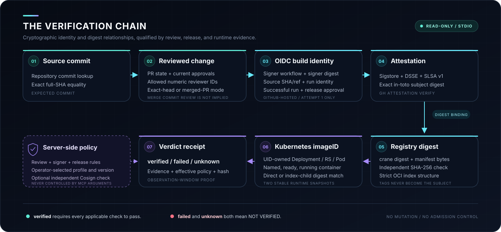

<h1 align="center">
  <a href="https://modelcontextprotocol.io">
    
  </a>
</h1>

<p align="center">
  <strong>A read-only Model Context Protocol server that produces an observation-window receipt linking a reviewed GitHub commit and approved workflow to the OCI image digest Kubernetes reported running.</strong>
</p>

<p align="center">
  <a href="#tests-and-verification"></a>
  <a href="pyproject.toml"></a>
  <a href="LICENSE"></a>
  <a href="https://modelcontextprotocol.io"></a>
  <a href="pyproject.toml"></a>
</p>

<p align="center">
  <a href="#what-it-does">What it does</a> |
  <a href="#verification-chain">Verification chain</a> |
  <a href="#quickstart">Quickstart</a> |
  <a href="#integration">Integration</a> |
  <a href="#security-model">Security</a> |
  <a href="#known-limitations">Limitations</a> |
  <a href="#faq">FAQ</a>
</p>

> [!IMPORTANT]
> This is an MVP evidence verifier, not an admission controller or a software-safety claim. Both `failed` and `unknown` mean **not verified** and must fail closed when used by a deployment gate.

## What it does

`release-proof-mcp` exposes exactly one MCP tool over stdio: `verify_release_deployment`.

It checks source and review records, GitHub Actions OIDC identity, Sigstore build provenance, GHCR manifest digests, release approval, and the named container's Kubernetes `imageID`. It then returns a structured receipt with per-check evidence, explicit missing coverage, the effective server-side policy, and a policy hash.

The high-value question is:

> During this observation window, did Kubernetes report running the OCI digest attested by the trusted GitHub Actions identity at the expected commit, and did the GitHub review and release records satisfy the operator's trusted policy?

A `verified` result means every applicable check passed. It does not mean the artifact is free of vulnerabilities, the workflow was benign, or the infrastructure was uncompromised.

| Verdict | Meaning | Required gate behavior |
| --- | --- | --- |
| `verified` | Every required check produced acceptable evidence and passed policy. | Validate the receipt subject, effective policy identity, and policy hash before relying on it. |
| `failed` | At least one check produced conclusive negative evidence. Any failure takes precedence over unknown checks. | Reject. |
| `unknown` | No check failed, but one or more checks lack sufficient evidence. `missing_coverage` identifies the gaps. | Reject; do not reinterpret unavailable evidence as absence or success. |

## Verification chain

<p align="center">
  
</p>

The diagram shows the evidence relationships. At execution time, the verifier takes an initial runtime snapshot and resolves the registry digest before verifying the attestation, then reconciles the runtime digest and takes a second snapshot.

| Chain link | What it proves when verified | What it does not prove |
| --- | --- | --- |
| Source commit (`source.commit`) | The requested repository exposes a commit whose full SHA exactly equals `expected_commit`. | Historical branch protection, source quality, or that the commit is safe. |
| Reviewed change (`source.review`) | The configured PR, current review decisions, exact head or merge commit, distinct allowed reviewer IDs, and non-author rule satisfy policy. | In `merged_pr` mode, direct review of the merge or squash commit; historical ruleset enforcement; reviewer infallibility. |
| OIDC build identity and run (`attestation.verification`, `workflow.run`) | The Sigstore certificate carries the GitHub Actions issuer, exact source repository/SHA/ref, trusted signer workflow/digest, GitHub-hosted runner, and run invocation. The matching run has the expected repository, workflow, event, commit, attempt, and successful conclusion. | An uncompromised signer or runner, a benign workflow, SLSA Build L3, or cryptographically complete derivation from source. |
| Attested artifact (`attestation.verification`) | `gh attestation verify` accepts Sigstore/DSSE evidence with SLSA v1 provenance and an in-toto subject equal to the resolved OCI digest. One fully acceptable result is sufficient. | Vulnerability absence, reproducibility, complete dependencies, or claims from workflow-controlled custom predicate fields. |
| Registry resolution (`registry.resolution`) | `crane` resolves the tag or digest, and the returned manifest bytes independently hash to that digest. OCI image indexes, Docker manifest lists, and single image manifests are structurally validated. | Future tag stability, registry availability, or that an unknown media type is acceptable. |
| Release approval (`release.approval`) | For certified run attempt 1, a historical approval names the exact environment and an allowed numeric approver ID, subject to the self-approval policy. | Attempt-bound approval on reruns, historical environment configuration, or a binding to a separate deployment run. |
| Optional Cosign signature (`signature.cosign`) | When required by policy, an additional independent Cosign verification succeeds for the pinned digest and expected GitHub identity. | That signed software is secure. GitHub artifact attestation already includes signature and provenance verification. |
| Runtime ownership and rollout (`runtime.rollout`) | UID ownership connects the named Deployment to ReplicaSets and Pods; the named container is running and ready, rollout counts agree, and nonzero replicas are requested. Labels alone do not establish ownership. | Node or kubelet integrity, or an unchanged container filesystem after startup. |
| Runtime digest (`runtime.digest_match`) | Each running target container's registry-comparable `imageID` equals the attested digest or is an exact descriptor child of the attested OCI index. | Anything from a bare local/config ID or unrecognized `imageID`; those produce `unknown`, not a fabricated match or mismatch. |
| Stable observation and receipt (`runtime.stable_observation`) | A second Kubernetes snapshot preserves target Pod UIDs, container IDs, image IDs, rollout revision, readiness, and related rollout evidence. The receipt records the effective policy and its SHA-256 hash. | Continuous monitoring, future restart behavior, admission enforcement, or authorization based on `verified` alone. |

Security decisions use certificate and verified-signing-time evidence, not workflow-controlled predicate fields such as `resolvedDependencies`. Approval comments and raw custom predicates are not copied into receipts.

## Quickstart

### Requirements

- Python 3.11 or newer. The runtime package has no third-party Python dependencies.
- [`gh`](https://cli.github.com/) 2.102.0 or newer. The version floor is enforced before attestation verification to retain exact signer-workflow and case-sensitive source-ref checks.
- [`crane`](https://github.com/google/go-containerregistry/tree/main/cmd/crane) for registry digest resolution and manifest retrieval.
- [`kubectl`](https://kubernetes.io/docs/tasks/tools/) for explicit-context Deployment, ReplicaSet, and Pod reads.
- [`cosign`](https://github.com/sigstore/cosign) only when the active policy sets `require_cosign_signature` to `true`.
- Read-only credentials already configured in the server environment and existing GitHub, registry, and Kubernetes credential stores.

GitHub.com and GHCR are the only supported services in this version.

### 1. Install

With access to the repository:

```sh
git clone https://github.com/okanyildiz/release-proof-mcp.git
cd release-proof-mcp
python3.11 -m venv .venv
. .venv/bin/activate
pip install -e .
```

### 2. Configure a trusted server-side policy

Save the following as `/secure/config/release-policy.json`, replacing every example repository, commit, PR, and numeric identity with values for your dedicated environment. Protect the file with operating-system permissions. It is policy, not a credential store.

```json
{
  "schema_version": "release-proof-policy/v1",
  "profiles": {
    "production": {
      "version": "2026-11-18.1",
      "signer_workflow": "acme/shop/.github/workflows/release.yml",
      "signer_digest": "89abcdef0123456789abcdef0123456789abcdef",
      "review": {
        "pull_request": 123,
        "mode": "merged_pr",
        "min_approvals": 1,
        "allowed_reviewer_ids": [1001, 1002],
        "require_non_author": true
      },
      "release": {
        "event": "push",
        "environment": "production",
        "required_approver_ids": [2001, 2002],
        "prevent_self_approval": true
      },
      "require_cosign_signature": false
    }
  }
}
```

The profile schema is closed and strictly validated. Reviewer and approver identities are positive numeric GitHub user IDs, not mutable login names. `signer_digest` may be `null` only for a same-repository signer pinned to `source_ref`; an external reusable builder always requires a full 40-character commit digest.

If the file contains multiple profiles, `RELEASE_PROOF_POLICY_PROFILE` is mandatory. A single-profile file can be selected without it. The MCP caller cannot select a profile or supply `review`, `release`, `require_cosign_signature`, or `policy_profile` arguments.

### 3. Start the MCP server

```sh
RELEASE_PROOF_POLICY_FILE=/secure/config/release-policy.json \
RELEASE_PROOF_POLICY_PROFILE=production \
release-proof-mcp
```

The transport is newline-delimited JSON-RPC 2.0 on stdio. The server supports MCP `initialize`, `ping`, `tools/list`, and `tools/call`, plus progress and cooperative cancellation for tool calls. Configure it as an MCP stdio server in your client; do not put credentials in tool arguments.

### 4. Call `verify_release_deployment`

The following is formatted for readability; a stdio client sends one JSON-RPC object per line.

```json
{
  "jsonrpc": "2.0",
  "id": 1,
  "method": "tools/call",
  "params": {
    "name": "verify_release_deployment",
    "arguments": {
      "repo": "acme/shop",
      "expected_commit": "0123456789abcdef0123456789abcdef01234567",
      "artifact": "ghcr.io/acme/shop:v1.4.0",
      "workflow": ".github/workflows/release.yml",
      "source_ref": "refs/heads/main",
      "signer_workflow": "acme/shop/.github/workflows/release.yml",
      "signer_digest": "89abcdef0123456789abcdef0123456789abcdef",
      "kube_context": "production",
      "namespace": "production",
      "deployment": "shop-api",
      "container": "api",
      "expected_run": {
        "id": 123456789,
        "attempt": 1
      }
    }
  }
}
```

Input rules that prevent ambiguous evidence:

- `expected_commit` and `signer_digest` are full lowercase 40-character commit SHAs. `source_ref` matching is exact and case-sensitive.
- `artifact` is `ghcr.io/...:tag` or `ghcr.io/...@sha256:...`. Verification uses the resolved digest, never the tag. Digest-form input cannot be moved to another digest by `crane`.
- `signer_workflow` defaults to `${repo}/${workflow}`. For a reusable workflow, identify the called workflow rather than its caller, and match the trusted profile exactly.
- `container` is mandatory; there is no fallback to `containers[0]`.
- `kube_context` is explicit; the current default kubectl context is never silently selected.
- `expected_run` is optional. Without it, the accepted certificate's `runInvocationURI` selects the run. Only attempt 1 is accepted.

### Example receipts

These receipts are abridged to the fields needed to understand the verdicts. Full `release-deployment-proof/v1` receipts also include timestamps, every applicable check, `effective_policy`, `evidence`, `evidence_truncation`, `tools`, and explicit `limitations`.

**Verified: every required check passed**

```json
{
  "schema_version": "release-deployment-proof/v1",
  "status": "verified",
  "summary": "Kubernetes reported the OCI image attested by the approved workflow at the expected commit; the server-side review and release policy passed.",
  "subject": {
    "repo": "acme/shop",
    "expected_commit": "0123456789abcdef0123456789abcdef01234567",
    "artifact_input": "ghcr.io/acme/shop:v1.4.0",
    "pinned_artifact": "ghcr.io/acme/shop@sha256:0c987afb70eaca35f5f47da7654ae92d10dc0103f9efd775d370e183301e12d7",
    "kube_context": "production",
    "namespace": "production",
    "deployment": "shop-api",
    "container": "api"
  },
  "policy_hash": "sha256:9c1ab13c9ac38c1f3dec2271e3fd23637f1cd8dc2f2f2317eb6c6f46287f4def",
  "reasons": [],
  "missing_coverage": []
}
```

**Failed: the certified run lacks the required production approval**

```json
{
  "schema_version": "release-deployment-proof/v1",
  "status": "failed",
  "summary": "Release deployment proof failed; no security or remediation claim is made.",
  "reasons": [
    {
      "check": "release.approval",
      "code": "RELEASE_APPROVAL_MISSING",
      "message": "No historical approved record names the required environment for this run.",
      "expected": "production"
    }
  ],
  "missing_coverage": []
}
```

**Unknown: the runtime changed during verification**

```json
{
  "schema_version": "release-deployment-proof/v1",
  "status": "unknown",
  "summary": "Release deployment proof is incomplete; explicit missing coverage remains.",
  "reasons": [
    {
      "check": "runtime.stable_observation",
      "code": "RUNTIME_CHANGED_DURING_VERIFICATION",
      "message": "Target Pod identity, container identity, imageID, rollout revision, or readiness changed during verification."
    }
  ],
  "missing_coverage": [
    {
      "check": "runtime.stable_observation",
      "code": "RUNTIME_CHANGED_DURING_VERIFICATION"
    }
  ]
}
```

Other honest degradations include `ATTESTATION_MISSING`, `PROVENANCE_MISSING`, `VERIFIER_OUTPUT_INVALID`, `ATTESTATION_SEARCH_TRUNCATED`, `TAG_MOVED`, `RUNTIME_DIGEST_MISMATCH`, `IMAGE_ID_NOT_REGISTRY_COMPARABLE`, and `SIGNATURE_MISSING`. Network failures, timeouts, trust-root retrieval problems, rate limits, and RBAC denials become unknown coverage rather than proof of absence.

A gate consumer must independently validate the returned subject, effective policy identity, and `policy_hash`. The hash covers the compact, key-sorted UTF-8 JSON representation of the effective policy; it is not a receipt signature.

## Integration

### GitHub Actions producer contract

The release workflow must check out and build the certified source commit, push to GHCR, capture the exact manifest or index digest emitted by the build/push step, and attest that digest. The attestation subject name must not contain a tag.

```yaml
name: release

on:
  push:
    branches: [main]

permissions:
  contents: read
  packages: write
  id-token: write
  attestations: write

jobs:
  release:
    runs-on: ubuntu-latest
    environment: production
    steps:
      - uses: actions/checkout@v4
        with:
          ref: ${{ github.sha }}

      # Replace with your builder. It must push the image and write the exact
      # pushed manifest/index digest as digest=sha256:... to $GITHUB_OUTPUT.
      - id: push
        run: ./ci/build-and-push.sh

      - uses: actions/attest@v4
        with:
          subject-name: ghcr.io/acme/shop
          subject-digest: ${{ steps.push.outputs.digest }}
          push-to-registry: true
```

`ci/build-and-push.sh` is an illustrative operator-supplied step, not a script shipped by this repository. The supported policy model expects build/attestation and protected-environment release approval in the same initial run. Reruns and separate build/deployment runs are not accepted.

For stronger builder isolation, use a protected reusable workflow pinned by full `signer_digest` in the server-side policy. A reusable workflow alone does not establish SLSA Build L3.

Producer references:

- [GitHub build provenance](https://docs.github.com/en/actions/security-for-github-actions/using-artifact-attestations/using-artifact-attestations-to-establish-provenance-for-builds)
- [`actions/attest`](https://github.com/actions/attest)
- [`gh attestation verify`](https://cli.github.com/manual/gh_attestation_verify)

### GHCR

Use an existing Docker/crane credential with package pull access and a GitHub token that can read repository contents, PRs, Actions, and attestations. No production mutation permission is needed.

Tags are accepted as input and resolved during verification. Digest input is also accepted, but `crane digest` must return the same digest. The verifier then retrieves the manifest by digest and hashes the exact returned bytes. For a multi-platform OCI index, the runtime may report either the index digest or an exact child descriptor digest; a child absent from the attested index fails.

### Kubernetes deployment

Deploy the exact digest produced by the release workflow. This example matches the tool input above; replace its documentation-only digest with your image's actual digest before applying it.

```yaml
apiVersion: apps/v1
kind: Deployment
metadata:
  name: shop-api
  namespace: production
spec:
  replicas: 2
  selector:
    matchLabels:
      app: shop
  template:
    metadata:
      labels:
        app: shop
    spec:
      containers:
        - name: api
          image: ghcr.io/acme/shop@sha256:0c987afb70eaca35f5f47da7654ae92d10dc0103f9efd775d370e183301e12d7
```

Grant the verifier only `get`/`list` access to the named Deployment and to ReplicaSets and Pods in that namespace. The verifier requires an explicit context and the container name. It reads Kubernetes before and after verification and returns `RUNTIME_CHANGED_DURING_VERIFICATION` if relevant identities or readiness change.

Digest-pinned deployment remains important: this receipt does not constrain a later restart or future tag pull.

## Security model

### Read-only by construction

The tool has no deploy, mutate, approve, remediate, or admission operation. External commands are evidence reads and verifiers: GitHub API/attestation commands, `crane digest`/`manifest`, Kubernetes version/get commands, and optional `cosign verify`.

Commands use argument vectors with `shell=False`, a 30-second default per-command cap, a 120-second overall deadline, bounded output, process-group termination, and cooperative cancellation. Serialized receipts over 512 KiB are rejected instead of returned as evidence claims.

### Credentials and privacy

- Never place tokens, kubeconfig data, registry credentials, or other secrets in MCP arguments or the policy file.
- Use least-privilege existing credentials in the server environment and tool-specific credential stores.
- Common token forms, Bearer values, authorization values, and configured environment secrets are redacted from retained diagnostics and tool-version output.
- Approval comments, authorization data, kubeconfig contents, registry credentials, and custom predicates are not retained in receipts.
- Resource names, commit IDs, numeric user IDs, evidence links, and effective policy can still be sensitive. Review receipts before sharing them.

### Policy is outside the caller's trust boundary

The server operator controls review rules, reviewer/approver numeric IDs, self-approval rules, signer workflow/digest, release environment, and the Cosign requirement. The active profile is selected by server configuration. Requests that name a different signer fail with `SIGNER_POLICY_MISMATCH` before attestation verification.

### Trust boundaries

The verifier trusts GitHub, Sigstore, GHCR, the Kubernetes API, and reported kubelet/runtime evidence to provide accurate source records, then independently checks the documented relationships. It does not defend against a compromised trust path, signer, runner, registry, Kubernetes control plane, kubelet, or node.

See [SECURITY.md](SECURITY.md) for the reporting process and operational recommendations.

## Tests and verification

At commit `8b996c1`, the local deterministic suite reports **218 passed, 1 skipped**. The skipped test is the opt-in live smoke test; the badge is a test-count badge, not a hosted CI status claim.

```sh
python -m pip install -e '.[test]'
python -m pytest -q
python -m compileall -q src tests
```

What is exercised locally:

- An argv-based fake adapter returns deterministic GitHub, attestation, GHCR, Kubernetes, and Cosign responses. Unexpected external commands fail the test.
- Real local Python subprocesses exercise timeout, process-tree cleanup, bounded output, cancellation, redaction, and `shell=False` behavior.
- Local MCP tests exercise JSON-RPC framing, the single-tool schema, structured receipts, progress, cancellation, and size limits.
- Cases cover pass/fail/unknown aggregation, policy matching, review state, release approvals, OCI structure, runtime ownership, digest reconciliation, injection rejection, and receipt bounds.
- No test invokes a production mutation command.

The external service integrations are mocked in the deterministic suite. A passing local suite is not evidence that a live GitHub/GHCR/Kubernetes/Cosign combination has been validated.

### Optional live smoke test

Run this only against a dedicated repository, GHCR image, and test cluster after replacing every example value. Configure credentials outside the command and policy file. The test calls the real verifier and asserts a `verified` result.

```sh
export RELEASE_PROOF_LIVE_SMOKE=1
export RELEASE_PROOF_POLICY_FILE=/secure/config/release-policy.json
export RELEASE_PROOF_POLICY_PROFILE=production
export RELEASE_PROOF_LIVE_INPUT='{"repo":"acme/shop","expected_commit":"0123456789abcdef0123456789abcdef01234567","artifact":"ghcr.io/acme/shop:v1.4.0","workflow":".github/workflows/release.yml","source_ref":"refs/heads/main","signer_workflow":"acme/shop/.github/workflows/release.yml","signer_digest":"89abcdef0123456789abcdef0123456789abcdef","kube_context":"production","namespace":"production","deployment":"shop-api","container":"api","expected_run":{"id":123456789,"attempt":1}}'
python -m pytest -q -m live tests/test_live_smoke.py
```

No live smoke result is claimed here. Live compatibility still needs evidence for real GitHub approval behavior, `gh` JSON contracts, GHCR manifest/index races, Kubernetes distributions and runtimes, Cosign trust configuration, and actual MCP clients.

## Known limitations

- **Live integration remains unverified.** The 218 passing tests are deterministic/local evidence, not a live provider compatibility matrix.
- **Windows process-tree cleanup needs platform validation.** The runner has a separate Windows `CREATE_NEW_PROCESS_GROUP` and `taskkill /T /F` path. The local process-tree tests exercise real subprocesses, but this macOS run does not establish Windows behavior.
- **Approvals are not attempt-bound.** GitHub's approval history is run-level. Only certified run attempt 1 is supported; rerun attempts fail with `RUN_ATTEMPT_UNSUPPORTED` rather than inheriting an approval.
- **No admission control or continuous enforcement.** The receipt covers an observation window. It does not block a deployment, prevent later changes, or guarantee what a future Pod restart pulls.
- **Only the documented provider and runtime path is supported.** GitHub.com, GHCR, a Kubernetes Deployment, and the named container are in scope. Other registries, source providers, workload types, and separate deployment workflows are not silently generalized.
- **Review evidence has a precise boundary.** `merged_pr` does not prove direct approval of the merge commit, and current records do not reconstruct historical branch or environment rules.
- **A signature is not a safety judgment.** There is no vulnerability, malware, reproducible-build, complete-dependency, node-integrity, or post-start filesystem guarantee.

Use digest-pinned deployments, isolated builders, admission enforcement, vulnerability scanning, and runtime monitoring alongside this verifier.

## Roadmap

These are investigation and implementation goals, not dated promises:

- [ ] Build a documented live integration matrix across real GitHub approvals, `gh`, GHCR, Kubernetes distributions/runtimes, Cosign, and MCP clients.
- [ ] Add providers only when equivalent source identity, signed provenance, immutable digest, and runtime evidence can be preserved.
- [ ] Add signed, canonical receipts and verification tooling; current receipts contain a policy hash but are not signed.
- [ ] Document reference gate-consumer patterns without presenting the observation receipt as admission control.

## FAQ

### Does `verified` mean the release is secure?

No. It means the documented evidence links and server-side policy passed during the observation window. It says nothing about vulnerability absence, reviewer correctness, workflow safety, or compromised infrastructure.

### What is the difference between `failed` and `unknown`?

`failed` records conclusive negative evidence, such as a digest mismatch or missing required approval. `unknown` means evidence is incomplete or unavailable, such as a timeout or non-comparable `imageID`. Neither is verified; a gate must reject both.

### Can the MCP caller choose a policy or approver?

No. The tool schema rejects policy arguments, including `policy_profile`, `review`, and `release`. The operator selects the profile through server configuration, and reviewer/approver identities in policy are immutable numeric GitHub user IDs.

### Why verify Kubernetes `imageID` instead of the Deployment's `image` string?

The spec may contain a mutable tag. A registry-comparable `imageID` reports the digest the runtime associated with the running container, allowing an exact comparison with the attested OCI object. It still does not prove node integrity or post-start filesystem integrity.

### Are multi-platform images supported?

Yes, within the documented OCI path. The runtime digest must equal the attested index digest or exactly match a descriptor in a recognized OCI image index or Docker manifest list. Unknown media types and contradictory manifest structures are rejected.

### Can I verify a rerun or a separate deployment workflow?

Not in this version. Only attempt 1 is accepted because run-level approval history cannot be safely bound to a rerun. A separate deployment run lacks a standard cryptographic binding to the image digest in this implementation.

### Is the receipt signed?

No. `policy_hash` identifies the effective policy; it does not sign the receipt. Signed receipts are a roadmap item. Protect the receipt transport and independently validate its subject and policy identity.

### Can this replace an admission controller?

No. It observes and reports evidence but does not mutate or block workloads. Keep admission-time signature/policy enforcement and digest-pinned deployment as separate controls.

## Contributing and support

Contributions are welcome through a focused, tested pull request. See [CONTRIBUTING.md](CONTRIBUTING.md) for setup, the PR process, and the security-sensitive review checklist.

- Use [GitHub Issues](https://github.com/okanyildiz/release-proof-mcp/issues) for bugs, reproducible evidence mismatches, documentation corrections, and live-integration results.
- GitHub Discussions is not currently enabled for this private repository. Use an issue for design questions until a discussions area is available.
- Do not disclose a suspected vulnerability in a public issue. Follow [SECURITY.md](SECURITY.md).
- Never attach live tokens, kubeconfig contents, registry credentials, approval comments, or sensitive production receipts.

## Author

**Okan YILDIZ**

- [GitHub profile](https://github.com/okanyildiz)
- [release-proof-mcp repository](https://github.com/okanyildiz/release-proof-mcp)
- [Buy Me a Coffee](https://buymeacoffee.com/okanyildizr)

## License

Released under the [MIT License](LICENSE).
