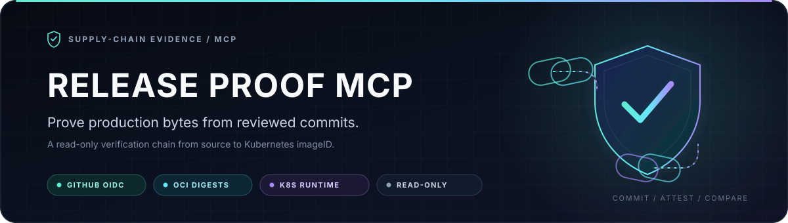

<h1 align="center">
  <a href="https://modelcontextprotocol.io">
    
  </a>
</h1>

<p align="center">
  <strong>A read-only Model Context Protocol server that produces an observation-window receipt linking a reviewed GitHub commit and approved workflow to the OCI image digest Kubernetes reported running.</strong>
</p>

<p align="center">
  <a href="#tests-and-verification"></a>
  <a href="pyproject.toml"></a>
  <a href="LICENSE"></a>
  <a href="https://modelcontextprotocol.io"></a>
  <a href="pyproject.toml"></a>
</p>

<p align="center">
  <a href="#what-it-does">What it does</a> |
  <a href="#verification-chain">Verification chain</a> |
  <a href="#quickstart">Quickstart</a> |
  <a href="GUIDE.md">Full usage guide</a> |
  <a href="#portable-signed-receipts-and-independent-gate">Signed gate</a> |
  <a href="#integration">Integration</a> |
  <a href="#security-model">Security</a> |
  <a href="#known-limitations">Limitations</a> |
  <a href="#faq">FAQ</a>
</p>

> [!IMPORTANT]
> This is an MVP evidence verifier, not an admission controller or a software-safety claim. Both `failed` and `unknown` mean **not verified** and must fail closed when used by a deployment gate.

## What it does

`release-proof-mcp` exposes exactly one MCP tool over stdio: `verify_release_deployment`.

It checks source and review records, GitHub Actions OIDC identity, Sigstore build provenance, GHCR manifest digests, release approval, and the named container's Kubernetes `imageID`. It returns a `release-deployment-proof/v2` receipt with a UUID4 ID, optional consumer nonce, complete subject, verifier and policy metadata, per-check evidence, and explicit missing coverage. Local receipts are unsigned by default; optional DSSE Ed25519 signing supports an independent consumer gate.

The high-value question is:

> During this observation window, did Kubernetes report running the OCI digest attested by the trusted GitHub Actions identity at the expected commit, and did the GitHub review and release records satisfy the operator's trusted policy?

A `verified` result means every applicable check passed. It does not mean the artifact is free of vulnerabilities, the workflow was benign, or the infrastructure was uncompromised.

| Verdict | Meaning | Required gate behavior |
| --- | --- | --- |
| `verified` | Every required check produced acceptable evidence and passed policy. | For portable gating, require a valid signed receipt and exact full-subject, verifier, policy-hash, issuer/key, nonce, and age expectations. |
| `failed` | At least one check produced conclusive negative evidence. Any failure takes precedence over unknown checks. | Deny, even when the receipt is signed for audit. |
| `unknown` | No check failed, but one or more checks lack sufficient evidence. `missing_coverage` identifies the gaps. | Deny, even when signed; do not reinterpret unavailable evidence as absence or success. |

## Verification chain

<p align="center">
  
</p>

The diagram shows the evidence relationships. At execution time, the verifier takes an initial runtime snapshot and resolves the registry digest before verifying the attestation, then reconciles the runtime digest and takes a second snapshot.

| Chain link | What it proves when verified | What it does not prove |
| --- | --- | --- |
| Source commit (`source.commit`) | The requested repository exposes a commit whose full SHA exactly equals `expected_commit`. | Historical branch protection, source quality, or that the commit is safe. |
| Reviewed change (`source.review`) | The configured PR, well-formed decision records with unique review IDs, current review decisions, exact head or merge commit, distinct allowed reviewer IDs, and non-author rule satisfy policy. | In `merged_pr` mode, direct review of the merge or squash commit; historical ruleset enforcement; reviewer infallibility. |
| OIDC build identity and run (`attestation.verification`, `workflow.run`) | The Sigstore certificate carries the GitHub Actions issuer, exact source repository/SHA/ref, trusted signer workflow/digest, GitHub-hosted runner, and run invocation. The matching run has the expected repository, workflow, event, commit, attempt, and successful conclusion. | An uncompromised signer or runner, a benign workflow, SLSA Build L3, or cryptographically complete derivation from source. |
| Attested artifact (`attestation.verification`) | `gh attestation verify` accepts Sigstore/DSSE evidence with SLSA v1 provenance and an in-toto subject equal to the resolved OCI digest. One fully acceptable result is sufficient. | Vulnerability absence, reproducibility, complete dependencies, or claims from workflow-controlled custom predicate fields. |
| Registry resolution (`registry.resolution`) | `crane` resolves the tag or digest, and the returned manifest bytes independently hash to that digest. OCI image indexes, Docker manifest lists, and single image manifests are structurally validated. | Future tag stability, registry availability, or that an unknown media type is acceptable. |
| Release approval (`release.approval`) | For certified run attempt 1, with the run's current attempt still 1, a historical approval names the exact environment and an allowed numeric approver ID, subject to the self-approval policy. | Attempt-bound approval on reruns, historical environment configuration, or a binding to a separate deployment run. |
| Optional Cosign signature (`signature.cosign`) | When required by policy, an additional independent Cosign verification succeeds for the pinned digest and expected GitHub identity. | That signed software is secure. GitHub artifact attestation already includes signature and provenance verification. |
| Runtime ownership and rollout (`runtime.rollout`) | UID ownership connects the named Deployment to ReplicaSets and Pods. Exactly the desired number of distinct owned Pod UIDs, nonempty target container IDs, and matching Deployment/owning ReplicaSet revisions are required; the named container is running and ready, rollout counts agree, and nonzero replicas are requested. Labels alone do not establish ownership. | Node or kubelet integrity, or an unchanged container filesystem after startup. |
| Runtime digest (`runtime.digest_match`) | Each running target container's registry-comparable `imageID` equals the attested digest or is an exact descriptor child of the attested OCI index. | Anything from a bare local/config ID or unrecognized `imageID`; those produce `unknown`, not a fabricated match or mismatch. |
| Stable observation and receipt (`runtime.stable_observation`) | A second Kubernetes snapshot preserves target Pod UIDs, container IDs, image IDs, rollout revision, readiness, and related rollout evidence. The receipt records the effective policy and its SHA-256 hash. | Continuous monitoring, future restart behavior, admission enforcement, or authorization based on `verified` alone. |

A conclusive runtime digest mismatch remains `failed` even when other runtime evidence is incomplete. `GH_VERSION_UNSUPPORTED` and `SIGNING_TIME_UNVERIFIED` are `unknown` outcomes, not conclusive failures.

Security decisions use certificate and verified-signing-time evidence, not workflow-controlled predicate fields such as `resolvedDependencies`. Approval comments and raw custom predicates are not copied into receipts.

## Quickstart

### Requirements

- Python 3.11 or newer. Runtime dependencies are pinned to `cryptography==50.0.2` and `jsonschema==4.26.0`; these pins alone do not make builds hermetic or reproducible.
- [`gh`](https://cli.github.com/) 2.102.0 or newer. The version floor is enforced before attestation verification to retain exact signer-workflow and case-sensitive source-ref checks.
- [`crane`](https://github.com/google/go-containerregistry/tree/main/cmd/crane) for registry digest resolution and manifest retrieval.
- [`kubectl`](https://kubernetes.io/docs/tasks/tools/) for explicit-context Deployment, ReplicaSet, and Pod reads.
- [`cosign`](https://github.com/sigstore/cosign) only when the active policy sets `require_cosign_signature` to `true`.
- Read-only credentials already configured in the server environment and existing GitHub, registry, and Kubernetes credential stores.

GitHub.com and GHCR are the only supported services in this version.

### 1. Install

Clone the repository:

```sh
git clone https://github.com/okanyildiz/release-proof-mcp.git
cd release-proof-mcp
python3.11 -m venv .venv
. .venv/bin/activate
pip install .
```

### 2. Configure a trusted server-side policy

Save the following as `/secure/config/release-policy.json`, replacing every example repository, commit, PR, and numeric identity with values for your dedicated environment. Protect the file with operating-system permissions. It is policy, not a credential store.

```json
{
  "schema_version": "release-proof-policy/v1",
  "profiles": {
    "production": {
      "version": "2026-11-18.1",
      "signer_workflow": "acme/shop/.github/workflows/release.yml",
      "signer_digest": null,
      "review": {
        "pull_request": 123,
        "mode": "merged_pr",
        "min_approvals": 1,
        "allowed_reviewer_ids": [1001, 1002],
        "require_non_author": true
      },
      "release": {
        "event": "push",
        "environment": "production",
        "required_approver_ids": [2001, 2002],
        "prevent_self_approval": true
      },
      "require_cosign_signature": false
    }
  }
}
```

The profile schema is closed and strictly validated. Reviewer and approver identities are positive numeric GitHub user IDs, not mutable login names. `signer_digest` may be `null` only for a same-repository signer pinned to `source_ref`; an external reusable builder always requires a full 40-character commit digest.

If the file contains multiple profiles, `RELEASE_PROOF_POLICY_PROFILE` is mandatory. A single-profile file can be selected without it. The MCP caller cannot select a profile or supply `review`, `release`, `require_cosign_signature`, or `policy_profile` arguments.

### 3. Start the MCP server

```sh
RELEASE_PROOF_POLICY_FILE=/secure/config/release-policy.json \
RELEASE_PROOF_POLICY_PROFILE=production \
release-proof-mcp
```

The server uses MCP `2025-06-18` over newline-delimited, strict UTF-8 JSON-RPC 2.0 on stdio. Clients must support this protocol version and complete `initialize` followed by `notifications/initialized` before `tools/list` or `tools/call`. Request IDs must be strings or integers; booleans and fractional numbers are rejected. The server also supports `ping`, progress without a fixed total, and cooperative cancellation. Do not put credentials in tool arguments.

#### Kimi Code

Replace `/absolute/path` with the repository's absolute path, then save this as `.kimi-code/mcp.json` in that project:

```json
{
  "mcpServers": {
    "release-proof": {
      "command": "/absolute/path/.venv/bin/release-proof-mcp",
      "cwd": "/absolute/path",
      "env": {
        "RELEASE_PROOF_POLICY_FILE": "/secure/config/release-policy.json",
        "RELEASE_PROOF_POLICY_PROFILE": "production"
      },
      "startupTimeoutMs": 30000,
      "toolTimeoutMs": 150000,
      "enabledTools": ["verify_release_deployment"]
    }
  }
}
```

Review the launch target in the project-trust prompt before trusting the folder. Start a new Kimi session after adding the server, then run `/mcp` to check its status; an existing session does not register a server added mid-session. Keep this machine-specific local configuration out of commits. See the [official Kimi Code MCP documentation](https://www.kimi.com/code/docs/en/kimi-code-cli/customization/mcp.html).

#### Claude Code

Replace `/absolute/path` and run this from the project directory:

```sh
claude mcp add --scope local --transport stdio release-proof \
  --env RELEASE_PROOF_POLICY_FILE=/secure/config/release-policy.json \
  --env RELEASE_PROOF_POLICY_PROFILE=production \
  -- /absolute/path/.venv/bin/release-proof-mcp
claude mcp get release-proof
```

The second command verifies the saved configuration and reports connection status. These two environment values are non-secret policy settings; credentials remain in existing credential stores. Keep local client configuration out of commits. See the [official Claude Code MCP documentation](https://code.claude.com/docs/en/mcp).

### 4. Call `verify_release_deployment`

The following is formatted for readability; a stdio client sends one JSON-RPC object per line.

```json
{
  "jsonrpc": "2.0",
  "id": 1,
  "method": "tools/call",
  "params": {
    "name": "verify_release_deployment",
    "arguments": {
      "repo": "acme/shop",
      "expected_commit": "0123456789abcdef0123456789abcdef01234567",
      "artifact": "ghcr.io/acme/shop:v1.4.0",
      "workflow": ".github/workflows/release.yml",
      "source_ref": "refs/heads/main",
      "consumer_nonce": "Ab09_-abcdefghijklmnopqrst",
      "kube_context": "production",
      "namespace": "production",
      "deployment": "shop-api",
      "container": "api",
      "expected_run": {
        "id": 123456789,
        "attempt": 1
      }
    }
  }
}
```

Input rules that prevent ambiguous evidence:

- `expected_commit` and any caller-supplied `signer_digest` are full lowercase 40-character commit SHAs. `source_ref` matching is exact and case-sensitive.
- `artifact` is `ghcr.io/...:tag` or `ghcr.io/...@sha256:...`. Verification uses the resolved digest, never the tag. Digest-form input cannot be moved to another digest by `crane`.
- `consumer_nonce` is an optional 22-128 character base64url challenge using only `A-Z`, `a-z`, `0-9`, `_`, and `-`. Generate a fresh value for each consumer evaluation; do not reuse this documentation value.
- `signer_workflow` and `signer_digest` are optional in MCP calls and inherit the active trusted policy when omitted. Any caller-supplied value must match that policy exactly or fail with `SIGNER_POLICY_MISMATCH`. External reusable signers therefore work without the caller duplicating these policy fields.
- `container` is mandatory; there is no fallback to `containers[0]`.
- `kube_context` is explicit; the current default kubectl context is never silently selected.
- `expected_run` is optional. Without it, the accepted certificate's `runInvocationURI` selects the run. Only attempt 1 is accepted, and the current run attempt must still be 1 when release approval is evaluated.

### Example receipts

These are abridged explanatory excerpts, not standalone consumer inputs. Full `release-deployment-proof/v2` receipts require a UUID4 `receipt_id`, nullable `consumer_nonce`, complete `verifier` and `subject` objects, `policy_descriptor`, timestamps, every applicable check, `effective_policy`, `evidence`, `evidence_truncation`, `tools`, and explicit `limitations`. See the [complete sanitized unsigned v2 fixture](tests/fixtures/receipt-v2.golden.json).

**Verified: every required check passed**

```json
{
  "schema_version": "release-deployment-proof/v2",
  "receipt_id": "123e4567-e89b-42d3-a456-426614174000",
  "consumer_nonce": "Ab09_-abcdefghijklmnopqrst",
  "status": "verified",
  "summary": "Kubernetes reported the OCI image attested by the approved workflow at the expected commit; the server-side review and release policy passed.",
  "subject": {
    "repo": "acme/shop",
    "expected_commit": "0123456789abcdef0123456789abcdef01234567",
    "artifact_input": "ghcr.io/acme/shop:v1.4.0",
    "pinned_artifact": "ghcr.io/acme/shop@sha256:0c987afb70eaca35f5f47da7654ae92d10dc0103f9efd775d370e183301e12d7",
    "kube_context": "production",
    "namespace": "production",
    "deployment": "shop-api",
    "container": "api"
  },
  "policy_hash": "sha256:9c1ab13c9ac38c1f3dec2271e3fd23637f1cd8dc2f2f2317eb6c6f46287f4def",
  "reasons": [],
  "missing_coverage": []
}
```

**Failed: the certified run lacks the required production approval**

```json
{
  "schema_version": "release-deployment-proof/v2",
  "status": "failed",
  "summary": "Release deployment proof failed; no security or remediation claim is made.",
  "reasons": [
    {
      "check": "release.approval",
      "code": "RELEASE_APPROVAL_MISSING",
      "message": "No historical approved record names the required environment for this run.",
      "expected": "production"
    }
  ],
  "missing_coverage": []
}
```

**Unknown: the runtime changed during verification**

```json
{
  "schema_version": "release-deployment-proof/v2",
  "status": "unknown",
  "summary": "Release deployment proof is incomplete; explicit missing coverage remains.",
  "reasons": [
    {
      "check": "runtime.stable_observation",
      "code": "RUNTIME_CHANGED_DURING_VERIFICATION",
      "message": "Target Pod identity, container identity, imageID, rollout revision, or readiness changed during verification."
    }
  ],
  "missing_coverage": [
    {
      "check": "runtime.stable_observation",
      "code": "RUNTIME_CHANGED_DURING_VERIFICATION"
    }
  ]
}
```

Other honest degradations include `ATTESTATION_MISSING`, `PROVENANCE_MISSING`, `VERIFIER_OUTPUT_INVALID`, `ATTESTATION_SEARCH_TRUNCATED`, `TAG_MOVED`, `RUNTIME_DIGEST_MISMATCH`, `IMAGE_ID_NOT_REGISTRY_COMPARABLE`, and `SIGNATURE_MISSING`. Network failures, timeouts, trust-root retrieval problems, rate limits, and RBAC denials become unknown coverage rather than proof of absence.

## Portable signed receipts and independent gate

### Architecture and flow

1. The consumer generates a fresh base64url `consumer_nonce` and includes it in the MCP tool call.
2. The producer collects the observation-window evidence and creates a v2 receipt with a UUID4 `receipt_id`, full subject, verifier identity, `policy_descriptor`, effective policy, and policy hash. Local receipts remain unsigned by default.
3. When signing is configured, the server validates the receipt and places a standard in-toto Statement, whose predicate contains the receipt and `proof_metadata`, into a DSSE envelope. It signs the DSSE pre-authentication encoding with Ed25519. The signed metadata contains `issuer`, `keyid`, `algorithm`, and `signed_at`. The server validates the signed result and never falls back to unsigned output after a signing failure. Optional package export adds the manifest descriptor before this single signing operation.
4. The independent consumer verifies either the stored receipt JSON or a five-file evidence package offline with `release-proof-verify`. It needs neither an AI/MCP session nor GitHub, GHCR, Kubernetes, or other provider credentials.

`policy_hash` is only the SHA-256 hash of the compact, key-sorted effective-policy JSON. It identifies policy content but is not a signature and does not authenticate the receipt. The DSSE proof binds the receipt and signed proof metadata to the trusted producer key. Failed and unknown receipts can be signed as audit records, but the consumer denies them.

### Optional MCP signing

Programmatic embedders can supply an Ed25519 private key directly with `MCPServer(signer=..., signing_issuer=..., signing_keyid=...)`; all three arguments are required together. For the stdio server, file-based signing requires this explicit development/test configuration:

```sh
chmod 600 /secure/keys/release-proof-ed25519.pem
export RELEASE_PROOF_SIGNING_KEY_FILE=/secure/keys/release-proof-ed25519.pem
export RELEASE_PROOF_SIGNING_ISSUER=https://issuer.example/release-proof
export RELEASE_PROOF_SIGNING_KEY_ID=release-proof-test-key
export RELEASE_PROOF_ALLOW_FILE_SIGNING_KEY=1
```

All four signing environment variables are required as a set. The file must contain an unencrypted Ed25519 private key in PEM form and be at most 16 KiB. On POSIX, use owner-only mode 600; any group or other permission bits are rejected. File keys are for development and testing only. Omit all signing configuration to retain the default unsigned local receipt.

For a version-pinned, non-exportable key, the server also implements OpenBao Transit signing over the exact raw DSSE PAE. The adapter verifies the returned signature with the pinned public key, requires HTTPS with hostname verification in production, disables redirects, bounds responses and end-to-end deadlines, and supports cancellation. Connection establishment and request sending are separately checked so no request bytes are sent after cancellation; a still-shutting-down worker rejects new requests until it exits. DNS resolution itself remains dependent on the runtime and egress environment. Plain HTTP requires an explicit loopback-only development opt-in.

```sh
export RELEASE_PROOF_OPENBAO_ADDRESS=https://openbao.example:8200
export RELEASE_PROOF_OPENBAO_TRANSIT_MOUNT=transit
export RELEASE_PROOF_OPENBAO_KEY_NAME=release-proof
export RELEASE_PROOF_OPENBAO_KEY_VERSION=1
export RELEASE_PROOF_OPENBAO_PUBLIC_KEY_FILE=/secure/keys/release-proof-public.pem
export RELEASE_PROOF_OPENBAO_TOKEN='<from-your-protected-credential-store>'
export RELEASE_PROOF_SIGNING_ISSUER=https://issuer.example/release-proof
export RELEASE_PROOF_SIGNING_KEY_ID=release-proof/transit/release-proof/v1
```

Use `RELEASE_PROOF_OPENBAO_KUBERNETES_ROLE` instead of a static token for Kubernetes service-account authentication; `RELEASE_PROOF_OPENBAO_CA_FILE` selects an operator CA bundle when needed. The key ID must end in the pinned `/v<version>`. File and OpenBao backends, partial configuration, and ambiguous authentication are rejected. Runtime signing needs only the Transit sign path, not private-key export. Production HSM backing, TLS operations, HA, sealing, audit behavior, and managed-cloud KMS are not validated by the local OpenBao development integration.

Optional `RELEASE_PROOF_VERIFIER_INSTANCE_ID` and `RELEASE_PROOF_BUILD_DIGEST` values populate `verifier.instance_id` and `verifier.build_digest`. The build digest is an operator-supplied assertion, not a measurement of the running binary or verified build provenance. Consumer verifier expectations include all four fields, including explicit null values.

### Signed evidence package export

Set `RELEASE_PROOF_EVIDENCE_PACKAGE_ROOT=/secure/evidence` together with one of the existing signing configurations to publish local evidence packages through the normal MCP verification path. The root is operator configuration, not an MCP tool argument. Programmatic embedders can use `MCPServer(..., evidence_package_root=...)`, or call `ReleaseVerifier.verify_detailed()` followed by `export_evidence_package()` with the same trusted policy and signing backend. Raw artifacts returned by `verify_detailed()` are export inputs, not additional receipt fields.

A successful export creates the operator-selected `root/<receipt_id>` directory with exactly five regular files: `receipt.json`, `manifest.json`, `effective-policy.json`, `sigstore-bundle.json`, and `oci-manifest.json`. There is no archive or extraction step. The manifest names only the policy, accepted Sigstore bundle, and OCI attachments with their exact sizes and hashes; it does not hash itself or the receipt. The receipt's optional `evidence_package.manifest_sha256` authenticates the canonical manifest through the existing DSSE signature. The bundle is the canonical accepted bundle whose hash matches `evidence.attestation.bundle_sha256`; the OCI file retains the exact `crane manifest` stdout bytes.

Package directories are mode 0700 and files are mode 0600 on POSIX. Publication uses a staged directory and rename, refuses an existing receipt ID, and cleans up partial output after signing, write, or rename failure. Export requires signing and is available only for `verified` receipts with empty `evidence_truncation`; other results produce no evidence-package claim.

### Independent consumer command

Save exact consumer expectations as JSON. Both objects are closed: every subject and verifier key shown below is required, and subsets or extra keys are rejected. These are sanitized golden-fixture values; replace them with the exact deployment and verifier values and use a newly generated nonce.

```json
{
  "subject": {
    "repo": "acme/shop",
    "expected_commit": "0123456789abcdef0123456789abcdef01234567",
    "artifact_input": "ghcr.io/acme/shop:v1.4.0",
    "pinned_artifact": "ghcr.io/acme/shop@sha256:0c987afb70eaca35f5f47da7654ae92d10dc0103f9efd775d370e183301e12d7",
    "source_ref": "refs/heads/main",
    "workflow": ".github/workflows/release.yml",
    "expected_run": {
      "id": 123456789,
      "attempt": 1
    },
    "source_repository_id": "555",
    "source_repository_owner_id": null,
    "kube_context": "production",
    "namespace": "production",
    "deployment": "shop-api",
    "container": "api"
  },
  "verifier": {
    "name": "release-proof-mcp",
    "version": "0.1.0",
    "instance_id": null,
    "build_digest": null
  }
}
```

Run the consumer against a signed receipt created for that same subject, verifier, policy, and nonce:

```sh
release-proof-verify /secure/evidence/receipt.json \
  --trusted-public-key /secure/keys/release-proof-public.pem \
  --keyid release-proof-test-key \
  --expectations /secure/config/consumer-expectations.json \
  --issuer https://issuer.example/release-proof \
  --policy-hash sha256:5094ccd7066bf0a4973f45528f74ff527fcdfb0114e3e2c3963ba5a7d54e562e \
  --nonce Ab09_-abcdefghijklmnopqrst \
  --max-age 300
```

To verify an exported package, replace `/secure/evidence/receipt.json` with `/secure/evidence/<receipt_id>` and keep every expectation and trust argument unchanged. A receipt containing `evidence_package` is not sufficient by itself: standalone verification denies it with `PACKAGE_REQUIRED`.

`--max-age` is a nonnegative number of seconds measured by the consumer from receipt `completed_at`. The CLI also rejects future observation/signing times and inverted observation windows. Nonce equality plus consumer-side age checking provides freshness, but there is no one-time replay cache; a caller requiring one-time use must generate and track fresh challenges itself.

The command prints bounded decision JSON and uses these process exit codes:

- `0`: allow; the receipt or package is verified and every signature, expectation, evidence, attachment, and freshness check passed.
- `1`: deny; this includes failed/unknown audit receipts, every truncated receipt (`EVIDENCE_TRUNCATED`), invalid proofs or packages, mismatched expectations, and stale evidence.
- `2`: input or usage error. Treat every nonzero exit as denial.

### Consumer trust boundary and limits

The consumer fails closed on v2 schema, semantic, and retained-evidence validation. It verifies the DSSE signature, signed metadata, exact full subject and verifier, policy hash and internal policy consistency, issuer and trusted public key, nonce, observation window, and consumer-side maximum age. It does not independently requery GitHub, GHCR, or Kubernetes, or rerun Sigstore cryptographic verification.

Package verification additionally requires the exact five-file set and no-follow regular files, validates the signed manifest digest and receipt ID, checks exact attachment sizes/hashes, requires canonical effective-policy and Sigstore bundle JSON, binds the bundle statement predicate and named subject to the receipt, and hashes the raw OCI bytes to the signed registry digest and media type. Every Pod marked `index_child` must name a digest present in that exact OCI index. Package-supplied keys are never trusted, and raw package contents are never printed.

The consumer still trusts the producer for live provider observations and data not retained in the receipt or package, including desired replica counts. A receipt alone does not retain the complete OCI index child list. Neither input form proves software safety, node integrity, admission enforcement, or post-start filesystem state.

Receipt, expectation, and trusted-public-key files are each limited to 2 MiB. Package limits are 2 MiB for the receipt, 1 MiB for policy, 64 KiB for the manifest, 8 MiB each for bundle and OCI, and 20 MiB total. Strict bounded UTF-8 JSON parsing rejects duplicate or escaped-duplicate keys, nonfinite numbers, and excessive nesting. Symlinks, FIFOs, directories in place of files, extra entries, and archive inputs are rejected. Denials suppress input and evidence contents rather than echoing them. The MCP server's separate 512 KiB serialized-receipt limit is enforced after optional signing and before package publication.

### Breaking migration from receipt v1

The v2 consumer rejects `release-deployment-proof/v1`; do not relabel a v1 receipt as v2. Producers must emit the new required receipt metadata and every full-subject field, including explicit nulls. Rename `evidence.pull_request.merge_commit_directly_reviewed` to `expected_commit_directly_reviewed`. Consumers must migrate to exact full-subject and full-verifier expectations and explicitly pin policy hash, issuer, trusted key ID/public key, nonce, and maximum age. See [COMPATIBILITY.md](COMPATIBILITY.md) for independent version contracts.

## Integration

### GitHub Actions producer contract

The release workflow must check out and build the certified source commit, push to GHCR, capture the exact manifest or index digest emitted by the build/push step, and attest that digest. The attestation subject name must not contain a tag.

```yaml
name: release

on:
  push:
    branches: [main]

permissions:
  contents: read
  packages: write
  id-token: write
  attestations: write

jobs:
  release:
    runs-on: ubuntu-latest
    environment: production
    steps:
      - uses: actions/checkout@v4
        with:
          ref: ${{ github.sha }}

      # Replace with your builder. It must push the image and write the exact
      # pushed manifest/index digest as digest=sha256:... to $GITHUB_OUTPUT.
      - id: push
        run: ./ci/build-and-push.sh

      - uses: actions/attest@v4
        with:
          subject-name: ghcr.io/acme/shop
          subject-digest: ${{ steps.push.outputs.digest }}
          push-to-registry: true
```

`ci/build-and-push.sh` is an illustrative operator-supplied step, not a script shipped by this repository. The supported policy model expects build/attestation and protected-environment release approval in the same initial run. Reruns and separate build/deployment runs are not accepted.

For stronger builder isolation, use a protected reusable workflow pinned by full `signer_digest` in the server-side policy. A reusable workflow alone does not establish SLSA Build L3.

Producer references:

- [GitHub build provenance](https://docs.github.com/en/actions/security-for-github-actions/using-artifact-attestations/using-artifact-attestations-to-establish-provenance-for-builds)
- [`actions/attest`](https://github.com/actions/attest)
- [`gh attestation verify`](https://cli.github.com/manual/gh_attestation_verify)

### GHCR

Use an existing Docker/crane credential with package pull access and a GitHub token that can read repository contents, PRs, Actions, and attestations. No production mutation permission is needed.

Tags are accepted as input and resolved during verification. Digest input is also accepted, but `crane digest` must return the same digest. The verifier then retrieves the manifest by digest and hashes the exact returned bytes. For a multi-platform OCI index, the runtime may report either the index digest or an exact child descriptor digest; a child absent from the attested index fails.

### Kubernetes deployment

Deploy the exact digest produced by the release workflow. This example matches the tool input above; replace its documentation-only digest with your image's actual digest before applying it.

```yaml
apiVersion: apps/v1
kind: Deployment
metadata:
  name: shop-api
  namespace: production
spec:
  replicas: 2
  selector:
    matchLabels:
      app: shop
  template:
    metadata:
      labels:
        app: shop
    spec:
      containers:
        - name: api
          image: ghcr.io/acme/shop@sha256:0c987afb70eaca35f5f47da7654ae92d10dc0103f9efd775d370e183301e12d7
```

Grant the verifier only `get`/`list` access to the named Deployment and to ReplicaSets and Pods in that namespace. The verifier requires an explicit context and the container name. It reads Kubernetes before and after verification and returns `RUNTIME_CHANGED_DURING_VERIFICATION` if relevant identities or readiness change.

Digest-pinned deployment remains important: this receipt does not constrain a later restart or future tag pull.

## Security model

### Read-only by construction

The tool has no deploy, mutate, approve, remediate, or admission operation. External commands are evidence reads and verifiers: GitHub API/attestation commands, `crane digest`/`manifest`, Kubernetes version/get commands, and optional `cosign verify`.

Commands use argument vectors with `shell=False`, a 30-second default per-command cap, a 120-second overall deadline, bounded output, process-group termination, and cooperative cancellation. The stdio loop drains and rejects frames over 1 MiB, limits tool calls to four concurrent workers, and rejects duplicate in-flight IDs. Serialized receipts over 512 KiB are rejected instead of returned as evidence claims.

### Credentials and privacy

- Never place tokens, kubeconfig data, registry credentials, or other secrets in MCP arguments or the policy file.
- Use least-privilege existing credentials in the server environment and tool-specific credential stores.
- Common token forms, Bearer values, authorization values, and configured environment secrets are redacted from command stderr and tool-version values used internally. Raw command stderr is not retained in receipts or operator logs; stable reason codes describe failures instead.
- Approval comments, authorization data, kubeconfig contents, registry credentials, and custom predicates are not retained in receipts.
- Resource names, commit IDs, numeric user IDs, evidence links, and effective policy can still be sensitive. Review receipts before sharing them.

### Policy is outside the caller's trust boundary

The server operator controls review rules, reviewer/approver numeric IDs, self-approval rules, signer workflow/digest, release environment, and the Cosign requirement. The active profile is selected by server configuration and supplies omitted signer fields. Caller-supplied signer values must match it exactly; any difference fails with `SIGNER_POLICY_MISMATCH` before attestation verification.

### Trust boundaries

The verifier trusts GitHub, Sigstore, GHCR, the Kubernetes API, and reported kubelet/runtime evidence to provide accurate source records, then independently checks the documented relationships. It does not defend against a compromised trust path, signer, runner, registry, Kubernetes control plane, kubelet, or node.

See [SECURITY.md](SECURITY.md) for the reporting process and operational recommendations.

## Tests and verification

The current offline suite reports **777 passed, 2 skipped**. The skipped tests are the opt-in live provider and real OpenBao integration tests; the badge is a test-count badge, not a hosted CI status claim.

```sh
python -m pip install '.[test]'
python -m pytest -q
python -m compileall -q src tests
```

What is exercised locally:

- An argv-based fake adapter returns deterministic GitHub, attestation, GHCR, Kubernetes, and Cosign responses. Unexpected external commands fail the test.
- Real local Python subprocesses exercise timeout, process-tree cleanup, bounded output, cancellation, redaction, and `shell=False` behavior.
- MCP protocol tests cover the initialization lifecycle, strict UTF-8 JSON, string/integer IDs with boolean and fractional IDs rejected, oversized-frame draining, concurrency and duplicate-ID rejection, progress, cancellation suppression, EOF/exception cleanup, and frame/receipt bounds.
- v2 receipt and consumer tests cover schema and retained-evidence invariants, in-toto/DSSE Ed25519 proofs, signed metadata, exact expectations, strict duplicate/nonfinite JSON rejection, nonce and age checks, audit-record denial, bounded CLI output, and exit codes.
- Adversarial regressions cover omitted-signer policy inheritance and mismatch rejection, malformed or duplicate review decisions, current-run reruns, exact distinct owned-Pod counts, missing container IDs, revision mismatches, and conclusive digest-mismatch precedence.
- Cases cover pass/fail/unknown aggregation, policy matching, release approvals, OCI structure, runtime ownership, digest reconciliation, injection rejection, and the 1 MiB frame and 512 KiB receipt limits.
- No test invokes a production mutation command.

Most external service integrations are mocked in the deterministic suite. The dedicated live result below is recorded separately; passing deterministic tests alone would not establish live interoperability.

### MCP client/protocol smoke evidence

Real MCP client calls succeeded at the protocol/tool level with Kimi Code 2.3.3 and Claude Code 2.1.323. Against the intentionally nonexistent `acme/shop` repository and a nonexistent Kubernetes context, both calls returned a receipt with overall status `failed` and `attestation.verification` status `unknown` with reason `GH_VERSION_UNSUPPORTED` on installed `gh` 2.86.0, without a crash.

This verifies the client initialization, protocol/tool invocation, and receipt-return path only. It is not evidence of a successful live GitHub/GHCR/Kubernetes release, and the installed `gh` did not meet the required 2.102.0 floor.

### Dedicated live vertical slice - verified

A dedicated fixture produced a real `verified` result across reviewed PR evidence, an approved initial GitHub Actions run, GHCR attestation, and a two-Pod kind deployment. The same receipt was signed through real OpenBao Transit and accepted by the independent consumer. Tampering returned `RECEIPT_INVALID`, a wrong nonce returned `NONCE_MISMATCH`, and a wrong container returned `CONTAINER_NOT_FOUND`.

The exact identities, digests, outcomes, tool versions, and limitations are recorded in [live interoperability evidence](docs/live-validation-2026-11-18.md). This is a single-operator fixture, not independent organizational review, production key custody, a provider/runtime matrix, or enterprise-readiness evidence.

### Live five-file package validation, 2026-11-20

A second dedicated run exercised development version `0.1.1` through real stdio MCP, private GHCR, the existing reviewed and approved initial run, a fresh two-Pod kind Deployment, real OpenBao Transit signing, and a five-file package export. The credential-free independent consumer returned `OK`; attachment tampering returned `ATTACHMENT_METADATA_MISMATCH`, a wrong nonce returned `NONCE_MISMATCH`, and descriptor-only input returned `PACKAGE_REQUIRED`. Both opt-in live tests passed separately. Exact identities, package hashes, local matrix results, and limits are recorded in [local live evidence-package validation](docs/live-validation-2026-11-20.md).

### Optional live provider smoke test

Run this only against a dedicated repository, GHCR image, and test cluster after replacing every example value. Configure credentials outside the command and policy file. The test calls the real verifier and asserts a `verified` result.

```sh
export RELEASE_PROOF_LIVE_SMOKE=1
export RELEASE_PROOF_POLICY_FILE=/secure/config/release-policy.json
export RELEASE_PROOF_POLICY_PROFILE=production
export RELEASE_PROOF_LIVE_INPUT='{"repo":"acme/shop","expected_commit":"0123456789abcdef0123456789abcdef01234567","artifact":"ghcr.io/acme/shop:v1.4.0","workflow":".github/workflows/release.yml","source_ref":"refs/heads/main","signer_workflow":"acme/shop/.github/workflows/release.yml","signer_digest":null,"kube_context":"production","namespace":"production","deployment":"shop-api","container":"api","expected_run":{"id":123456789,"attempt":1}}'
python -m pytest -q -m live tests/test_live_smoke.py
```

The optional test is the reproduction path for a new dedicated environment; the recorded fixture above is the evidence for this run. It does not establish a broader compatibility matrix. Private-repository attestation/environment support must be rechecked against the account's GitHub plan, and GHCR package visibility is configured separately from repository visibility.

## Known limitations

- **Live evidence is limited to two dedicated single-operator fixtures.** The 2026-11-18 run validated the provider path and standalone signed receipt. The 2026-11-20 run added a real private-GHCR, kind, stdio MCP, OpenBao five-file package export and independent consumer allow/deny. There is still no provider/runtime matrix, Cosign result, production cluster result, native Windows result, hosted CI result, release-artifact attestation, or independent organizational adoption evidence.
- **Signed consumption does not remove producer trust.** The consumer validates retained evidence but does not requery upstream providers or reconstruct desired replica counts. A receipt alone does not retain the complete OCI index child list; a package binds the exact index bytes but still relies on the producer's accepted live observations.
- **Freshness is not one-time replay prevention.** Nonce and age checks require caller-side challenge discipline; the consumer has no replay cache.
- **Production key operations and remote evidence distribution remain open.** The OpenBao adapter, local package export, and real development integration work, but production TLS, HSM backing, HA, sealing, audit operations, managed-cloud KMS, and authenticated remote package distribution are not implemented or validated.
- **Windows process-tree cleanup needs platform validation.** The runner has a separate Windows `CREATE_NEW_PROCESS_GROUP` and `taskkill /T /F` path. Local macOS and Docker Linux process tests do not establish native Windows behavior; a real Windows runner is still required.
- **Approvals are not attempt-bound.** GitHub's approval history is run-level. Only certified run attempt 1 is supported, and the current run attempt must still be 1 when approval is evaluated; reruns fail with `RUN_ATTEMPT_UNSUPPORTED` rather than inheriting an approval.
- **Stdout backpressure can impede responsiveness.** Writes and flushes block while `_write_lock` is held, so a stalled client pipe can delay other output. Cancellation is cooperative. Use `serve()` for supported stdio concurrency; direct concurrent in-process `handle()` calls are not a supported substitute.
- **No admission control or continuous enforcement.** The receipt covers an observation window, and the consumer returns a decision without mutating or blocking workloads. Neither constrains later changes or future Pod image pulls.
- **Only the documented provider and runtime path is supported.** GitHub.com, GHCR, a Kubernetes Deployment, and the named container are in scope. Other registries, source providers, workload types, and separate deployment workflows are not silently generalized.
- **Review evidence has a precise boundary.** `merged_pr` does not prove direct approval of the merge commit, and current records do not reconstruct historical branch or environment rules.
- **A signature is not a safety judgment.** There is no vulnerability, malware, reproducible-build, complete-dependency, node-integrity, or post-start filesystem guarantee.

Use digest-pinned deployments, isolated builders, admission enforcement, vulnerability scanning, and runtime monitoring alongside this verifier.

## Roadmap

The v2 receipt, DSSE Ed25519 signing, local evidence packages, and independent consumer foundation are implemented. This is not an enterprise-readiness claim: live, adoption, and operational gates remain. Remaining investigation and implementation goals have no dated promises:

- [x] Complete a recorded single-operator vertical slice across GitHub, GHCR, kind, OpenBao signing, and independent consumer denial/allowance.
- [x] Implement version-pinned OpenBao Transit signing with public-key self-verification and validate the real development API path.
- [x] Define a signed five-file evidence package with local atomic export and independent offline package verification.
- [ ] Expand the provider/client matrix and validate production TLS, HSM/key custody, rotation, audit, HA, and managed-cloud KMS operations.
- [ ] Add authenticated remote evidence-package distribution.
- [ ] Add authenticated, isolated remote execution cells.
- [ ] Implement nonblocking stdio output and high availability, and validate Windows process cleanup.
- [ ] Add providers only when equivalent source identity, signed provenance, immutable digest, and runtime evidence can be preserved.

## FAQ

### Does `verified` mean the release is secure?

No. It means the documented evidence links and server-side policy passed during the observation window. It says nothing about vulnerability absence, reviewer correctness, workflow safety, or compromised infrastructure.

### What is the difference between `failed` and `unknown`?

`failed` records conclusive negative evidence, such as a digest mismatch or missing required approval. `unknown` means evidence is incomplete or unavailable, such as a timeout or non-comparable `imageID`. Neither is verified; a gate must reject both.

### Can the MCP caller choose a policy or approver?

No. The tool schema rejects policy arguments, including `policy_profile`, `review`, and `release`. The operator selects the profile through server configuration, and reviewer/approver identities in policy are immutable numeric GitHub user IDs.

### Why verify Kubernetes `imageID` instead of the Deployment's `image` string?

The spec may contain a mutable tag. A registry-comparable `imageID` reports the digest the runtime associated with the running container, allowing an exact comparison with the attested OCI object. It still does not prove node integrity or post-start filesystem integrity.

### Are multi-platform images supported?

Yes, within the documented OCI path. The runtime digest must equal the attested index digest or exactly match a descriptor in a recognized OCI image index or Docker manifest list. Unknown media types and contradictory manifest structures are rejected.

### Can I verify a rerun or a separate deployment workflow?

Not in this version. Only certified attempt 1 is accepted, and the run's current attempt must still be 1 when release approval is evaluated, because run-level approval history cannot be safely bound to a rerun. A separate deployment run lacks a standard cryptographic binding to the image digest in this implementation.

### Is the receipt signed?

Only when explicitly configured. Local v2 receipts omit `proof` and `proof_metadata` by default. Signed receipts use an in-toto Statement and DSSE Ed25519 proof; `policy_hash` alone is not a signature. Use `release-proof-verify` with exact expectations and a trusted public key. File-based signing keys are for development/testing only.

### Can this replace an admission controller?

No. It observes and reports evidence but does not mutate or block workloads. Keep admission-time signature/policy enforcement and digest-pinned deployment as separate controls.

## Contributing and support

Contributions are welcome through a focused, tested pull request. See [CONTRIBUTING.md](CONTRIBUTING.md) for setup, the PR process, and the security-sensitive review checklist.

- Use [GitHub Issues](https://github.com/okanyildiz/release-proof-mcp/issues) for bugs, reproducible evidence mismatches, documentation corrections, and live-integration results.
- GitHub Discussions is not currently enabled for this repository. Use an issue for design questions until a discussions area is available.
- Do not disclose a suspected vulnerability in a public issue. Follow [SECURITY.md](SECURITY.md).
- Never attach live tokens, kubeconfig contents, registry credentials, approval comments, or sensitive production receipts.

## Author

**Okan YILDIZ**

- [GitHub profile](https://github.com/okanyildiz)
- [release-proof-mcp repository](https://github.com/okanyildiz/release-proof-mcp)
- [Buy Me a Coffee](https://buymeacoffee.com/okanyildizr)

## License

Released under the [MIT License](LICENSE).
